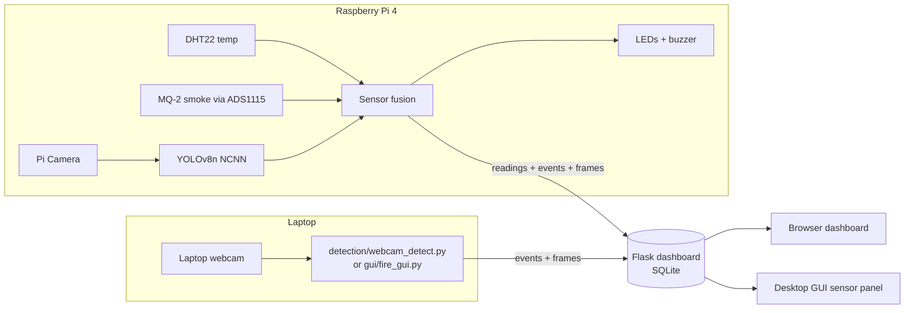

# Smart Fire Detection System

**Final-year project.** It detects fire and smoke in real time with a **YOLOv8** model. A camera is combined with
**temperature (DHT22)** and **smoke (MQ-2)** sensors on a **Raspberry Pi 4**. Alerts appear on a
**web dashboard** and a **desktop GUI**.


## Team

| Member | Role | Main folder | Guide |
|---|---|---|---|
| **Tanishka Yadav** | Data collection + YOLOv8 training | `model/` | [docs/03_model_training.md](docs/03_model_training.md) |
| **Tanishk Khandelwal** | Website / web dashboard | `dashboard/` | [docs/04_web_dashboard.md](docs/04_web_dashboard.md) |
| **Tanmay Vyas** | Hardware demo: Raspberry Pi + sensors | `hardware/` | [docs/05_hardware.md](docs/05_hardware.md) |
| **Shubham Aggarwal** | Desktop GUI | `gui/` | [docs/06_desktop_gui.md](docs/06_desktop_gui.md) |

The shared code in `common/` (detector, sensor fusion, alerts, dashboard client) is owned by the whole team.

## Documentation

1. [Project overview, architecture and 6-month roadmap](docs/01_project_overview.md)
2. [Month-1 plan: week-by-week tasks for every member](docs/02_month1_plan.md)
3. [Model training guide (Tanishka)](docs/03_model_training.md)
4. [Web dashboard guide + API reference (Tanishk)](docs/04_web_dashboard.md)
5. [Hardware guide: circuit, parts list, wiring, Pi setup (Tanmay)](docs/05_hardware.md)
6. [Desktop GUI guide (Shubham)](docs/06_desktop_gui.md)
7. [Testing and evaluation plan](docs/07_testing_and_evaluation.md)
8. [Final report outline and viva preparation](docs/08_report_outline.md)

Circuit diagram: [`docs/images/circuit_diagram.svg`](docs/images/circuit_diagram.svg) (PNG version beside it).

## Project structure

```
smart-fire-detection/
├── config.yaml              one settings file for every part (thresholds, pins, dashboard URL, API key)
├── common/                  shared code
│   ├── detector.py          FireDetector: YOLOv8 or (before training) a colour-based demo detector
│   ├── fusion.py            camera + temperature + smoke  ->  SAFE / WARNING / FIRE + risk score
│   ├── alerts.py            "N frames in a row" debouncing + cooldown, laptop beep
│   └── dashboard_client.py  sends events / readings / preview frames to the dashboard
├── model/            (Tanishka) collect_frames, prepare_dataset, train, evaluate, export, Colab notebook
├── detection/        month-1 demo: webcam_detect.py (laptop webcam, OpenCV window)
├── dashboard/        (Tanishk)  Flask server + SQLite + HTML/CSS/JS dashboard
├── gui/              (Shubham)  Tkinter desktop control panel
├── hardware/         (Tanmay)   Pi monitor, sensor drivers, calibration, component checks, setup script
├── docs/                        all documentation and diagrams
└── tests/                       pytest tests (fusion, detector, dashboard API, dataset tool)
```

## Quick start (laptop)

```bash
cd smart-fire-detection
python -m venv .venv
.venv\Scripts\activate          # Windows    (macOS/Linux: source .venv/bin/activate)
pip install -r requirements.txt

# 1. web dashboard  ->  open http://localhost:5000
python -m dashboard.app

# 2. in a second terminal: fire detection on the laptop webcam, sending alerts to the dashboard
python -m detection.webcam_detect

# 3. or the desktop GUI
python -m gui.fire_gui

# 4. simulated Raspberry Pi sensors (no hardware needed) so the dashboard shows temperature/smoke
python -m hardware.pi_fire_monitor --simulate --no-camera

# tests
pytest
```

> **Before the model is trained**, `model/weights/best.pt` does not exist yet. All parts then fall back to a
> simple **colour-based demo detector**, which is clearly marked "DEMO" on screen. The dashboard, GUI and
> hardware work can therefore start in week 1. Once Tanishka copies the trained `best.pt` into
> `model/weights/`, every part uses YOLOv8 automatically. Never report results from the demo detector.

## How it works



A fire alarm is raised only when the evidence agrees. A very confident camera detection counts on its own.
Otherwise the camera must agree with a sensor, or both temperature and smoke must be high. A single source
on its own only raises a warning. This is what keeps false alarms low. See `common/fusion.py`.
