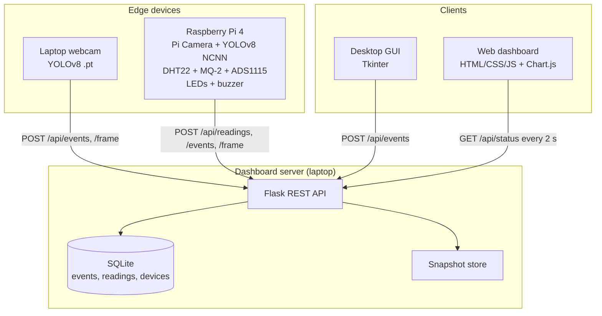

# 1. Project overview

## 1.1 Abstract

Fire accidents in homes, hostels, labs, warehouses and server rooms cause heavy loss of life and property.
Conventional smoke detectors react late: smoke must physically reach the ceiling sensor. They also cannot
tell anyone remotely what is happening. This project builds a **Smart Fire Detection System** that combines

* **computer vision**: a YOLOv8 object detector trained to find *fire* and *smoke* in camera images,
* **environmental sensing**: a DHT22 temperature/humidity sensor and an MQ-2 smoke/gas sensor on a Raspberry Pi 4,
* **sensor fusion**: camera and sensor evidence combined into one risk level (SAFE / WARNING / FIRE),
* **local alarms**: buzzer and LEDs,
* **remote monitoring**: a web dashboard and a desktop GUI with live video, sensor graphs, alert history and snapshots.

## 1.2 Problem statement

Design and build a low-cost system that detects fire **earlier** than a smoke detector by looking for visible
flames and smoke with a camera. It must also produce **fewer false alarms** than a camera-only system by
confirming with temperature and smoke sensors. Alerts must reach the people responsible in real time.

## 1.3 Objectives

1. Build and label a fire/smoke image dataset, including our own images and hard negatives.
2. Train a YOLOv8 model with **mAP@50 ≥ 0.80** on the held-out test set. Compare YOLOv8n and YOLOv8s.
3. Run real-time detection on a laptop webcam (≥ 15 FPS) and on a Raspberry Pi 4 (≥ 4 FPS with NCNN).
4. Interface the DHT22 and MQ-2 sensors with the Pi and fuse them with the camera output.
5. Build a web dashboard: live status, camera view, sensor trends, alert history with snapshots, CSV export.
6. Build a desktop GUI to operate the detector (camera choice, model choice, threshold, logs, snapshots).
7. Evaluate the system: detection metrics, false-alarm rate, detection latency and a live demo.

## 1.4 Scope and limitations

* Indoor, camera-visible fires. A fire hidden behind a wall is detected only by the sensors.
* The MQ-2 gives a relative smoke level, not calibrated ppm. Calibrated ppm needs lab gas.
* The system is a **prototype for an academic project**, not a certified fire alarm. Demos with real flame
  (candle, matchstick, small controlled fire) must be done under supervision with an extinguisher nearby.

## 1.5 System architecture

### Data flow of one alert
1. A frame is captured and passed to `FireDetector.detect()`, which returns boxes such as `fire 0.83`.
2. `fusion.assess()` combines the best fire/smoke confidence with the latest temperature and smoke readings.
   It returns a level, a 0–100 score and human-readable reasons.
3. `AlertTracker` raises an alert only if fire is present in **N consecutive frames** (default 5). It then
   waits a **cooldown** (30 s) before raising the next one.
4. The device turns on its LEDs/buzzer and POSTs the event with a JPEG snapshot to the dashboard.
5. The dashboard stores it, turns the banner red, plays an alarm and lists it in the history until it is acknowledged.

### Fusion rules (`common/fusion.py`)

| Situation | Level |
|---|---|
| Nothing unusual | SAFE |
| Camera sees fire/smoke with low confidence, **or** one sensor above its warning threshold | WARNING |
| Camera fire confidence ≥ 0.60 | FIRE |
| Camera sees fire/smoke **and** at least one sensor is above its warning threshold | FIRE |
| Temperature ≥ 57 °C **and** smoke ≥ 50 % (no camera needed) | FIRE |

Risk score = 50 × camera + 25 × temperature + 25 × smoke. Each part is scaled from 0 to 1 between its thresholds.
All thresholds are in `config.yaml`.

## 1.6 Technology stack

| Layer | Technology |
|---|---|
| Detection model | Ultralytics YOLOv8 (PyTorch); NCNN export for the Pi |
| Training | Google Colab (T4 GPU) or a laptop with an NVIDIA GPU |
| Labelling | Roboflow / Label Studio / makesense.ai (YOLO format) |
| Edge hardware | Raspberry Pi 4 (4 GB), Pi Camera Module 3/v2, DHT22, MQ-2, ADS1115, buzzer, LEDs |
| Pi libraries | picamera2, gpiozero, adafruit-circuitpython-dht, adafruit-circuitpython-ads1x15 |
| Backend | Python 3.10+, Flask, SQLite |
| Web frontend | HTML, CSS, vanilla JavaScript, Chart.js (bundled locally, works offline) |
| Desktop GUI | Tkinter + Pillow + OpenCV |
| Testing | pytest |

## 1.7 Six-month roadmap

| Month | Goal | Tanishka (model) | Tanishk (website) | Tanmay (hardware) | Shubham (GUI) |
|---|---|---|---|---|---|
| **1** | **Working laptop demo** | Dataset v1 + first YOLOv8n model; laptop webcam detection | Dashboard v1: status, live feed, events, sensor chart | Buy parts, set up the Pi, wire and test each sensor, circuit diagram | GUI v1: live view, controls, alert log |
| 2 | Better model, connected system | Own data + hard negatives, YOLOv8n vs v8s comparison, hyper-parameter tuning | Login, device management page, alerts by e-mail/Telegram | Sensors + Pi camera together in `pi_fire_monitor.py`, MQ-2 calibration | Settings page, connect to dashboard, sensor panel |
| 3 | Edge deployment | NCNN/ONNX export, speed vs accuracy at 320/416/640 | Mobile layout, charts per device, history filters | YOLO on the Pi (NCNN), FPS optimisation, enclosure | Video file analysis mode, report export |
| 4 | Integration + reliability | Error analysis: false positives/negatives, retrain | Deploy on LAN / free cloud, HTTPS, multi-camera view | Auto-start service, power-loss recovery, relay for a sprinkler/fan (optional) | Package as a .exe (PyInstaller) |
| 5 | Testing + evaluation | Final metrics on the test set, latency tests | Usability testing, bug fixes | Field tests: candle, paper, incense, false-alarm sources | Usability testing, bug fixes |
| 6 | Report + demo | Results chapter | Website chapter, screenshots | Hardware chapter, demo rig | GUI chapter, final presentation, demo video |

Monthly milestone for the guide: every month ends with a **demo plus a 1-page progress report** containing what
was done, metrics or screenshots, problems and next month's plan.
