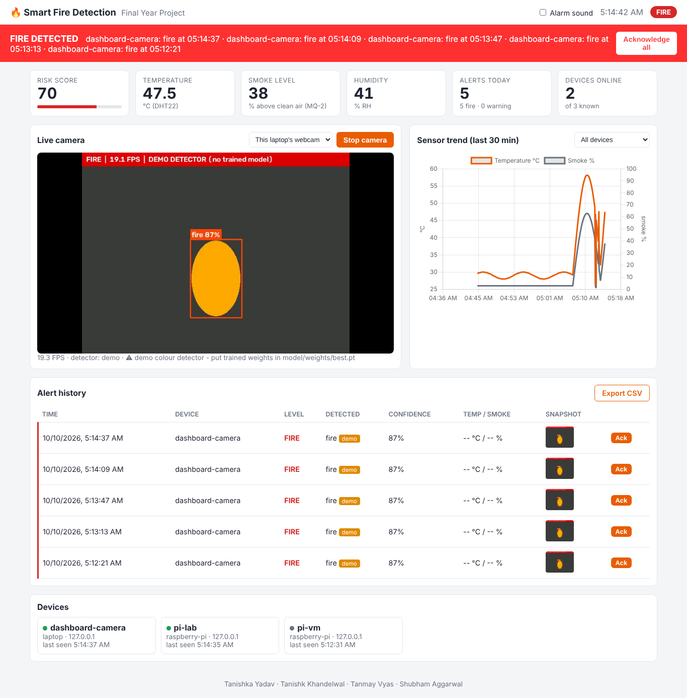

# 4. Web dashboard: Tanishk Khandelwal

The dashboard is the central screen of the system. Every device (laptop detector, desktop GUI, Raspberry Pi)
sends its data here. Anyone on the same Wi-Fi opens it in a browser.

```bash
python -m dashboard.app          # http://localhost:5000  (others on the LAN: http://<laptop-ip>:5000)
```



## 4.1 Features (month 1)

| Feature | Where |
|---|---|
| Overall status pill + banner (green SAFE / orange WARNING / flashing red FIRE) with reasons | `index.html` header, `app.js renderStatus()` |
| Alarm sound in the browser when the status turns FIRE (tick "Alarm sound") | `app.js alarm()` (Web Audio) |
| Tiles: risk score gauge, temperature, smoke %, humidity, alerts today, devices online | `renderStatus()` |
| **Live camera.** "Start camera" runs YOLOv8 on the laptop webcam inside the server (MJPEG stream). The drop-down also shows preview frames from the Pi / other detectors | `dashboard/camera.py`, `/video_feed` |
| Sensor trend chart (temperature + smoke, last 30 min, per device) | `renderChart()`, Chart.js (bundled, works offline) |
| Alert history with level, confidence, sensor values, snapshot thumbnails (click to enlarge), acknowledge buttons | `renderEvents()` |
| CSV export of all alerts (for the report) | `/api/events.csv` |
| Devices list with online/offline state | `renderDevices()` |
| Works on phones (responsive layout) | `style.css` |

## 4.2 Code structure

```
dashboard/
├── app.py          Flask app factory, all routes, API-key check, status calculation
├── db.py           SQLite tables: events, readings, devices
├── camera.py       background thread: webcam -> detector -> MJPEG frames + alerts
├── templates/index.html
└── static/
    ├── style.css   colours are CSS variables; dark mode automatic
    ├── app.js      polls /api/status + /api/events every 2 s, chart every 10 s
    └── vendor/chart.umd.min.js
```

The browser **polls** every 2 s instead of using WebSockets. It is simpler, works through every network and is
fast enough for alerts. Socket.IO push is a good month-3 upgrade.

## 4.3 API reference

Device endpoints need the header `X-API-Key: <dashboard.api_key from config.yaml>`. **Change the key** before
the demo. Browser endpoints are open on the LAN for month 1. Login comes in month 2.

| Method | Path | Who calls it | Body / response |
|---|---|---|---|
| POST | `/api/events` | detectors, Pi | `{device, kind, level: WARNING\|FIRE, label, confidence, score?, reasons?, temperature?, smoke?, detector_mode?, snapshot_jpeg_b64?}` → `201 {id}` |
| POST | `/api/readings` | Pi | `{device, kind, temperature?, humidity?, smoke?, smoke_digital?, fire_conf?, smoke_conf?}` → `201 {level, score, reasons}` (the server runs the same fusion) |
| POST | `/api/devices/<id>/frame` | detectors, Pi | `{kind, jpeg_b64}`, the latest preview frame (memory only) |
| GET | `/api/devices/<id>/frame.jpg` | browser | latest preview JPEG |
| GET | `/api/status` | browser, GUI | `{level, score, reasons, active_alerts, readings[], devices[], today{total,fire,warning}, camera{running,fps,mode,error}}` |
| GET | `/api/events?limit=50` | browser | newest events first |
| GET | `/api/events.csv` | browser | CSV download |
| POST | `/api/events/<id>/ack`, `/api/events/ack_all` | browser | acknowledge |
| GET | `/api/readings?minutes=30&device=pi-1` | browser | readings for the chart |
| POST | `/api/camera/start` `{source?}`, `/api/camera/stop` | browser | local webcam on/off |
| GET | `/video_feed` | browser `` | MJPEG stream |

Example from any language:
```bash
curl -X POST http://localhost:5000/api/readings -H "X-API-Key: change-me-fire-2026" \
     -H "Content-Type: application/json" -d '{"device":"test","temperature":61,"smoke":70}'
```

**How the overall status is calculated:** it is the highest of (a) the latest reading of every device seen in
the last 30 s, (b) any **unacknowledged** alert from the last 5 minutes and (c) the local camera.
Acknowledging alerts turns the banner back to green.

## 4.4 Month-2+ ideas (your roadmap)

1. **Login** (Flask-Login, hashed passwords) and roles: admin / viewer.
2. **Notifications:** e-mail (SMTP) and a Telegram bot message with the snapshot on every FIRE event.
3. Device page: rename devices, set location ("Lab 3, 2nd floor"), per-device thresholds.
4. History page with date filters, charts per day, false-alarm marking (feeds back into Tanishka's dataset).
5. Socket.IO for instant push; deployment on a Raspberry Pi or a free cloud VM with HTTPS.

## 4.5 Testing

`pytest tests/test_dashboard.py` covers the API key check, event + snapshot flow, acknowledge, fusion of
readings, frame upload and bad input. Add a test for every new endpoint.
