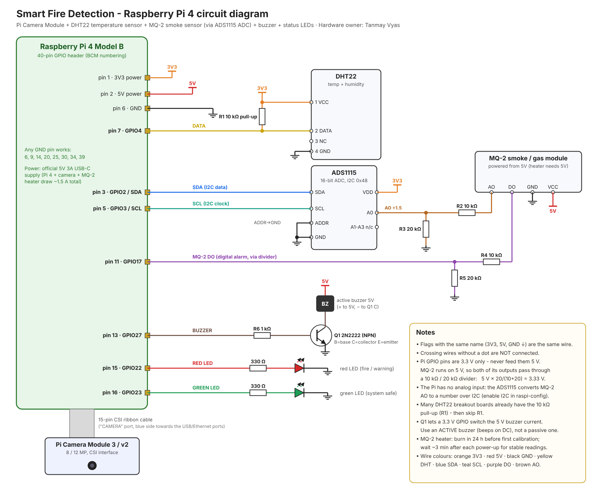

# 5. Hardware: Raspberry Pi 4 + camera + temperature + smoke: Tanmay Vyas



Source: [`images/circuit_diagram.svg`](images/circuit_diagram.svg). It is generated by
`python -m hardware.make_circuit_diagram`, so edit that script if pins change.

## 5.1 Bill of materials

Prices are approximate Indian online prices (2026). Check before ordering.

| # | Part | Qty | Purpose | ≈ ₹ |
|---|---|---|---|---|
| 1 | Raspberry Pi 4 Model B, 4 GB | 1 | Main computer | 5,500 |
| 2 | Official 5 V 3 A USB-C power supply | 1 | A weak supply causes random crashes | 700 |
| 3 | microSD card 32 GB, Class 10 / A1 | 1 | Raspberry Pi OS | 400 |
| 4 | Raspberry Pi Camera Module 3 (or v2) + 15-pin ribbon | 1 | Video for YOLOv8 | 2,500 (v2 ≈ 1,800) |
| 5 | DHT22 (AM2302) module | 1 | Temperature + humidity | 300 |
| 6 | MQ-2 gas/smoke sensor module | 1 | Smoke | 150 |
| 7 | ADS1115 16-bit ADC module | 1 | The Pi has no analog input | 350 |
| 8 | Active buzzer 5 V | 1 | Local alarm | 30 |
| 9 | 2N2222 (or BC547) NPN transistor | 1 | Lets the GPIO switch the buzzer | 5 |
| 10 | LEDs 5 mm red + green | 2 | Status | 5 |
| 11 | Resistors: 330 Ω ×2, 1 kΩ ×1, 10 kΩ ×3, 20 kΩ ×2 | 8 | See diagram | 20 |
| 12 | Breadboard (830 points) + jumper wires (M-M, M-F, F-F) | 1 set | Prototyping | 250 |
| 13 | Heat sinks / fan case for the Pi 4 | 1 | YOLO makes the Pi hot | 400 |
| | **Total** | | | **≈ 10,600** |

Month 3+ (optional): 5 V relay module (sprinkler/fan/exhaust demo), acrylic enclosure, 20 kΩ can be two 10 kΩ in series.

## 5.2 Pin connections

| Component pin | Connects to | Pi physical pin | BCM |
|---|---|---|---|
| DHT22 VCC (1) | 3.3 V | 1 | 3V3 |
| DHT22 DATA (2) | GPIO4 + 10 kΩ pull-up to 3.3 V | 7 | GPIO4 |
| DHT22 GND (4) | GND | 9 | GND |
| ADS1115 VDD | 3.3 V | 17 | 3V3 |
| ADS1115 GND, ADDR | GND (ADDR→GND gives address 0x48) | 14 | GND |
| ADS1115 SDA | SDA | 3 | GPIO2 |
| ADS1115 SCL | SCL | 5 | GPIO3 |
| ADS1115 A0 | MQ-2 AO through the divider (R2 10 kΩ from AO, R3 20 kΩ to GND) | | |
| MQ-2 VCC | **5 V** | 2 | 5V |
| MQ-2 GND | GND | 6 | GND |
| MQ-2 DO | Divider (R4 10 kΩ, R5 20 kΩ to GND) → GPIO17 | 11 | GPIO17 |
| Buzzer + | 5 V | 4 | 5V |
| Buzzer − | Q1 collector | | |
| Q1 base | 1 kΩ → GPIO27 | 13 | GPIO27 |
| Q1 emitter | GND | 20 | GND |
| Red LED anode (long leg) | 330 Ω → GPIO22; cathode → GND | 15 | GPIO22 |
| Green LED anode | 330 Ω → GPIO23; cathode → GND | 16 | GPIO23 |
| Camera | CSI "CAMERA" port, ribbon contacts facing the HDMI side (blue tab towards the USB/Ethernet ports) | | |

Pin numbers can be changed in `config.yaml → sensors`.

### Why each part is there (likely viva questions)
* **ADS1115.** MQ-2 gives an analog voltage, but the Pi's GPIO is digital only. The ADS1115 converts it over I2C.
* **Voltage dividers.** MQ-2 runs at 5 V, so its outputs can reach 5 V. Pi GPIO and the 3.3 V-powered ADS1115
  must not see more than 3.3 V. With 10 kΩ/20 kΩ the output is V × 20/30, so 5 V becomes 3.33 V. The code multiplies the
  reading by 1.5 to get the real voltage back. On DO the divider also loads the module's pull-up, so HIGH reads
  ≈ 2.5 V. That is still a clean logic HIGH for the Pi.
* **Transistor for the buzzer.** A GPIO pin gives only a few mA at 3.3 V. The transistor switches the buzzer's
  current from the 5 V rail. The 1 kΩ limits base current.
* **330 Ω for the LEDs.** (3.3 V − 2 V) / 330 Ω ≈ 4 mA. That is bright enough and safe for the GPIO.
* **10 kΩ pull-up on DHT22 DATA.** The single-wire protocol needs it. Many DHT22 *modules* already include it.

## 5.3 Assembly order (test after every step)

1. **Power off.** Wire the green LED + 330 Ω → `python -m hardware.check_components leds`
2. Buzzer + transistor + 1 kΩ → `check_components buzzer`
3. DHT22 → `check_components dht`. Warm it with your hand and watch the temperature rise.
4. ADS1115 → `check_components i2c`. Address **48** must appear.
5. MQ-2 with both dividers → `check_components mq2`. Blow out a matchstick or light incense near it; AO voltage rises.
6. Camera → `check_components camera`, then open `camera_test.jpg`.

## 5.4 Raspberry Pi software setup

1. Raspberry Pi Imager → **Raspberry Pi OS (64-bit) Bookworm**. In settings: hostname `firepi`, user `pi`, Wi-Fi, SSH on.
2. `ssh pi@firepi.local`, copy the project, then `bash hardware/setup_pi.sh`. This installs packages, enables I2C and creates a venv.
3. MQ-2: leave it powered **24 h** the first time (heater burn-in), then in clean air:
   `python -m hardware.calibrate_mq2 --seconds 60` → saves `hardware/mq2_calibration.json`.
4. Set `dashboard.url` in `config.yaml` to the laptop's IP (`ipconfig`/`ip a`), e.g. `http://192.168.1.20:5000`.
   Both devices must be on the same Wi-Fi. Allow port 5000 in the Windows firewall.
5. Run:
   ```bash
   python -m hardware.pi_fire_monitor --no-camera     # month 1: sensors only
   python -m hardware.pi_fire_monitor                 # month 2+: Pi camera + YOLOv8 NCNN + sensors
   ```
6. Month 4: auto-start at boot with `hardware/fire-monitor.service` (instructions inside the file).

No hardware yet? `python -m hardware.pi_fire_monitor --simulate --no-camera` runs the whole pipeline on a laptop
with realistic fake values. A simulated "fire" happens every 2 minutes.

## 5.5 What the outputs mean

| Level | Green LED | Red LED | Buzzer |
|---|---|---|---|
| SAFE | on | off | off |
| WARNING | off | blinking | off |
| FIRE | off | on | beeping |

## 5.6 Performance tips for YOLO on the Pi 4

* Use the **NCNN** export at imgsz **320**. Expect roughly 5–8 FPS with YOLOv8n; PyTorch `.pt` gives ~1 FPS.
  Measure it yourself and put the numbers in the report.
* Use a heat sink + fan. The Pi throttles at 80 °C (`vcgencmd measure_temp`).
* Use a 64-bit OS and avoid running the desktop GUI on the Pi during benchmarks.

## 5.7 Safety for demos

* Test the MQ-2 with incense sticks or a blown-out matchstick. Never use LPG near a flame.
* Only small, supervised flames (candle, lighter) on a non-flammable surface, with water/extinguisher nearby, with the guide's permission.
* Keep the DHT22 at least 15 cm from the flame. Use a hair dryer to test temperature thresholds.
