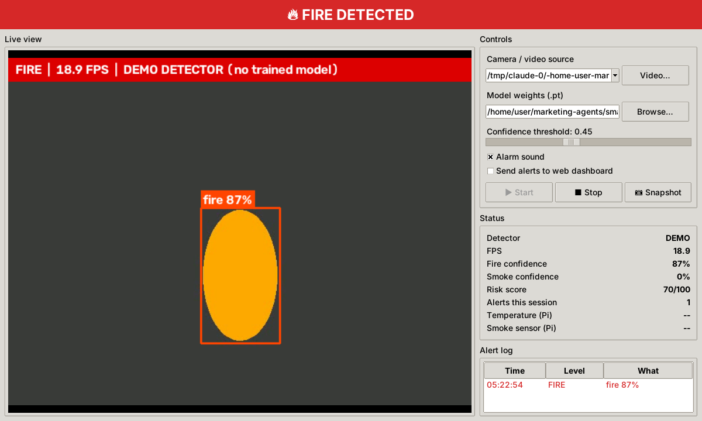

# 6. Desktop GUI: Shubham Aggarwal

A desktop control panel for operators who prefer an application to a browser. It runs the detector itself on
the laptop camera or a video file. It can also forward alerts to the web dashboard.

```bash
python -m gui.fire_gui
```
(On Linux/Raspberry Pi install Tk first if needed: `sudo apt install python3-tk`.)



## 6.1 Screen layout

```
┌────────────────────────────────────────────────────────────────────────┐
│  🔥 FIRE DETECTED   (banner: grey OFF / green SAFE / orange / red)     │
├───────────────────────────────────────────────┬────────────────────────┤
│                                               │ Controls               │
│                                               │  Camera/video source ▾ │
│              Live view                        │  Model weights  [...]  │
│        (annotated YOLOv8 frames)              │  Confidence ───●────   │
│                                               │  ☑ Alarm sound         │
│                                               │  ☐ Send to dashboard   │
│                                               │  [▶ Start][■ Stop][📷] │
│                                               │ Status                 │
│                                               │  Detector, FPS, fire % │
│                                               │  smoke %, risk score,  │
│                                               │  alerts, Pi temp/smoke │
│                                               │ Alert log (table)      │
├───────────────────────────────────────────────┴────────────────────────┤
│ status bar: "Model loaded: best.pt"                                    │
└────────────────────────────────────────────────────────────────────────┘
```

## 6.2 Features (month 1)

* Camera index (0/1/2) or **video file** (`Video…`) as source, which helps test without a real fire.
* Choose the weights file (`.pt`/`.onnx`). Falls back to the demo detector if none is found.
* **Confidence slider** applied live, with no restart.
* Coloured status banner and statistics: FPS, fire/smoke confidence, risk score, alert count.
* **Alert log** (time, level, what was detected) and a laptop beep on every alert.
* **Snapshot** button that saves to `outputs/snapshots/`.
* **Send to web dashboard** sends events and preview frames to the dashboard. While it is on, the panel also shows the
  Raspberry Pi's temperature and smoke values from the dashboard.

## 6.3 Design

| Concern | Solution |
|---|---|
| The window must not freeze while YOLO runs | `DetectionWorker` thread does capture + inference and puts results on a `queue.Queue`. The Tk main loop reads the queue every 30 ms with `after()`. Tkinter widgets are only touched from the main thread |
| GUI slower than the camera | The worker drops old frames when the queue has more than 2 items, so the view stays live |
| Same logic as the other parts | Uses `common.detector`, `common.fusion`, `common.alerts`, so results match the dashboard and the Pi |
| Portability | Tkinter ships with Python (Windows/macOS/Linux/Pi). Only Pillow is extra |

## 6.4 Month-2+ roadmap

1. Settings window (dashboard URL, API key, thresholds) saved to a user config file.
2. Click an alert to view its snapshot. "Open snapshots folder" button.
3. **Video analysis mode:** process a whole video file and output a report (timestamps of fire, max confidence).
4. Multi-camera grid (2×2).
5. Package as a Windows `.exe` with PyInstaller: `pyinstaller --onefile --windowed -n FireDetector gui/fire_gui.py`
   (add `--add-data` for `config.yaml` and the weights).
6. Optional modern look with CustomTkinter, or a port to PyQt5 if the team prefers Qt Designer.

## 6.5 Test checklist

- [ ] Starts with no weights (demo mode shown in the status bar)
- [ ] Starts with `best.pt`; detector shows YOLO
- [ ] Video file plays and ends with a message
- [ ] Slider changes detections live
- [ ] Stop → Start again works; closing the window while running does not hang
- [ ] With "Send to dashboard" on, the alert appears in the browser with its snapshot
